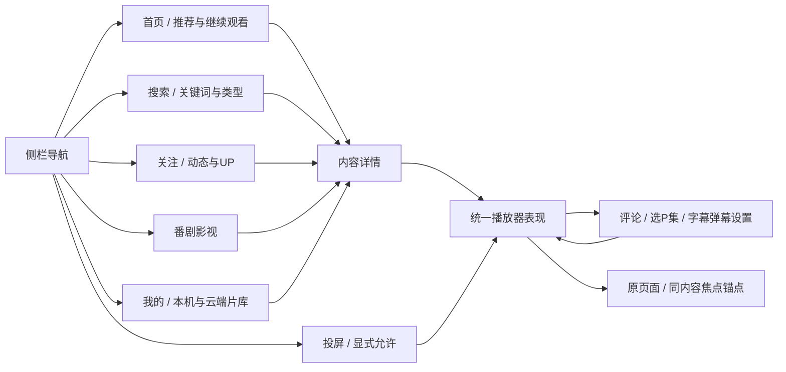

# BiliSofa 大屏产品设计

2026-10-23：前端三批（ADR-088、090–094）已落到已安装0.47.2，所请求组USER PASS；此前状态见[签名与部署记录](SIGNING_DEVICE_RECORD.md)。U4/U5未完成；小数倍速只有未集成候选。

## 1. 产品主线

让用户坐在沙发上完成“找到内容→判断是否想看→播放/继续→保存下一次观看”。首次进入就出现可浏览内容；账号登录不阻塞游客浏览；投屏是独立、显式允许的入口。界面不再以“读取接口/运行检查”为主任务。

采用 **YouTube的创作者与视频组织、Netflix的清晰发现/个人片库、B站的UP/分P/番剧与只读弹幕语义**。这是一套适合现有能力的项目设计，不是对三家当前TV客户端逐页复刻。Netflix已公开采用顶部导航，BiliSofa选侧栏是本项目对六个目的地和横向视频卡的取舍，不能称行业统一标准。

当前不展示直播、不提供双账号产品流程；评论/回复/弹幕只读。F11可逆互动保留产品入口设计，实际可用性由能力状态决定；F14暂停及云进度未知结果不因换UI而消失。不增加购物、会员购买、短视频无限刷、AI问答或后台唤醒。

## 2. 信息架构

| 主导航 | 内容与二级入口 | 游客/特殊状态 |
| --- | --- | --- |
| 首页 | 继续观看（本机）、当前账号推荐或游客热门、热门/全站榜与分区入口 | 无本机记录不占空货架；推荐未登录展示游客热门并标明来源 |
| 搜索 | 一个输入入口；视频 / UP主 / 番剧影视；热搜与本机历史 | 不再分别放四个搜索按钮；无直播标签；历史关闭时不持久化 |
| 关注 | 关注更新、UP入口；完整动态/图文/视频与投稿 | 未登录引导扫码；来源阻塞显示局部错误，不能以导航更新冒充完整动态 |
| 番剧影视 | 搜索/现有可用内容、已追列表、详情与选集 | 无现成榜单来源就不杜撰推荐；权益由实际来源决定 |
| 我的 | 继续观看、本机队列、稍后再看、收藏夹、云端历史、追番 | 游客可用本机记录/队列；私人片库展示登录提示；区分本机/云端 |
| 投屏 | 待机说明、允许本次会话、当前连接/控制权、结束会话 | 不隐式开监听；前台运行、同网、iOS本地网络权限说明 |

设置位于侧栏底部；账号（单账号详情、扫码、游客、移除）是设置的第一组（ADR-113 P1-2b，0.62.0起侧栏不再单列“账号”）。已有多账号数据/代码保留；不为了新UI强制迁移、删除或要求第二账号。普通页面不出现包版本、W编号、API阶段、UNVERIFIED或防重日志；诊断在“设置→帮助与诊断”，异常仍有可展开代码。

## 3. 视觉与布局基线

以1920×1080逻辑画布设计，按实际viewport做一次统一缩放和AVPlay坐标转换。4K视频与UI分辨率独立。以下为**项目初始目标**，不是三星认证数值，实机远距修正后固定token。

| 项目 | 初始规格 |
| --- | --- |
| 风格 | 深夜蓝背景、暖白文字、粉色焦点（ADR-072的实现基线）；封面承担色彩，少边框/阴影，不抄B站/Netflix品牌资产 |
| 颜色 | 背景`#0C1524`、面板`#16263B`、主文`#F4F7FB`、次文`#A9BAD0`、焦点`#FB7299`；警示辅以图形/文字，不能只变色 |
| 安全区/网格 | 侧栏从x/y=48px起、收起宽112px；内容起点x=224/y=64px，右缘1856；内容宽1632px、间距28px；展开侧栏288px覆盖浏览区但不重排卡片 |
| 字体 | 电视可用中文无衬线/系统回退；正文30–32px、辅助26–28px、章节36–40px、页题48–56px；不从外网加载字体；必要随包字体须核查许可/大小 |
| 控件 | 一般高度64–72px；导航项78px；焦点5px外轮廓＋轻微底色，可选1.025缩放；不把selected当focused |
| 封面卡 | UGC 16:9；每行4张、每张约387×218px封面＋最多两行标题＋一行UP/时长；番剧详情/精选可用2:3海报，搜索结果保持统一可读 |
| 动画 | 焦点100–150ms、面板160–220ms；长按快速移动不排队播放动画；减少动画时去缩放/位移。无自动有声预览或动态大背景 |
| 长文本 | 卡片不自动跑马灯；焦点/详情显示完整标题，朗读保留全文；正文独立滚动，不能靠缩小字容纳长简介 |

0.35.0内容浏览补充：首屏之后按方向下自动接续，三批/最多十二卡DOM窗口，向上回读前批并保持焦点；不再以显式上一页/下一页作为常规浏览动作。原接口与查询范围仍保留，见ADR-077。

0.46.0首页改为货架（继续观看/推荐/热门/排行榜，行尾“查看更多”进入原网格），详情为整页并带分P列表（ADR-091）。首页不放占大半屏的装饰hero。顶栏y=48–112；第一货架标题y≈144、封面y≈196，第二货架标题y≈578、封面y≈630；两行的标题/UP仍留在安全区。存在本机记录时首行“继续观看”，否则直接推荐/热门。每张卡一个焦点，不在封面上嵌一排小按钮；确认进入详情。

0.61.0视觉调整（[ADR-114](adr/114-tv-layout-and-visual-pass.md)）：样式变量集中在`body.product-ui`（颜色、字号四档`--tv-fs-page/section/card/aux`=48/36/28/22px、圆角14px、焦点5px粉色外轮廓）。首页只留一行身份小字，首屏约2.4排货架；货架卡改为340px宽（一行约4.6张，露出下一张），标题28px最多两行、“UP · 播放数”22px紧贴标题；“查看更多”网格仍为每行4张、标题保留两行高度。加载中的货架显示同尺寸骨架卡，失败的货架只占一行。内容卡片聚焦时外轮廓上方加两根“天线”（唯一的特色元素，其余界面保持克制）。首页与详情页用卡片已加载的封面做模糊暗化背景：不额外请求、播放时不绘制、可整体关闭；它随焦点淡入淡出，不是动态大背景。设备上装载封面拖慢方向键，0.61.1起关闭（`BACKDROP_ENABLED`）。

封面通过已实现的通用DTO与受限图床合同加载，保持内容与图片来源对应。无封面用随包、可访问的统一后备图和标题；不使用随机网络图冒充视频，不把样例画面当真实加载成功。

## 4. 页面与主要流程

### 首页、榜单和分区

- 首页挂载即加载当前合法来源，内容可分区就绪；第一批卡出现前提供可返回的骨架，单一区块失败不盖掉全页/本机记录。
- 各货架横向浏览，下一屏预取一次；到尾有“查看更多”，进入有页码/滚动指示的网格。只有实际有更多时出现继续加载；不把不足一页的收藏当可翻页。
- 榜单/分区通过同页筛选或二级浏览，名称与来源对应。仅焦点移动不刷新请求；确认筛选才加载，失败保留原内容并明确其为旧结果。
- 按内容ID与身份代次保留页码、筛选、焦点、滚动；后台更新不把用户推回首卡。

### 搜索

- 一页完成输入、热搜/历史与结果（ADR-092/094）：左侧常驻键盘与候选，右侧热搜/历史与结果。默认不逐字请求；选中候选即搜索，也可按“搜索”键；结果到达前及无结果/失败时焦点留在“搜索”键。视频/UP/番剧是结果类型，不是三套独立键盘。
- 展开时左侧560px用于关键词、2×4候选和6列字母/数字键；右侧1056px可展示三列结果。输入字母与已选关键词分开显示；候选只选词，不误执行搜索。
- 采用已有拼音首字母能力。编辑过程中第一次Back清首字母、再次退出输入区；恢复搜索入口/结果锚点，保留已确认词。系统IME可用时仍由统一owner管理。
- 结果切类型/翻页确认加载；HTTP412、超时、无结果有不同提示。沿用安全GET的有界重试，不新增“试到成功”的手动循环或私自伪造客户端身份。

### 内容详情、UP和番剧

- UGC详情（从卡片长按菜单的“详情”进入，ADR-113）：封面、完整标题、UP入口、时长/发布时间/必要统计与权益；主按钮“播放”或“继续观看 · P2 12:34”，次按钮“从头播放/加入本机队列”；更多动作放单独一行。
- 续播（ADR-113）：有本机进度时直接从进度继续，不弹询问；控制层显示并聚焦“从头播放”，首帧后8 s收起。设置里的“自动续播”关闭时一律从头。播放器主行按↓打开快捷设置条：画质、倍速、弹幕、字幕、连播。
- 分P/合集是明确的内容列表，显示P号、名称、时长、已看状态；多P大量数据分页/虚拟化，不一次挂载全部。记录与队列键仍为BV＋P。
- UP主页：头像/名称/真实关系、投稿和动态分类；关注/取消位于UP头部并复用F11能力。无法读取投稿时显示该区域原因，不能只把搜索预览重新命名为主页。
- 番剧详情：真实封面/简介/评分（存在时）、播放/继续、选集、追番状态；付费/地区/不可用集有原因。不会因为上次选4K就把缺4K的一集判不可播。
- 所有入队/收藏/稍后再看都标清**本机还是账号云端**；入队不得伴随真实云写。

### 我的、记录与队列

- “继续观看/本机记录”显示**视频标题＋P名称/集号＋已看/总长＋时间**，BV只在次要详情；旧标题补取失败仍可识别并操作，不阻塞其他记录。
- “本机队列”有顺序号、P号、当前项；卡片确认打开动作面板：从此项播放、上移、下移、移除。禁用边界项不占方向路径；删除后落最近邻。
- “云端历史/稍后再看/收藏夹”共用浏览卡与列表壳，但每种数据自己的权限/游标/空态。云历史关闭不诱导用户开启；不自动补写观看历史。
- “管理记录”是次级入口；逐P删除与清空预览说明保留项，默认焦点为取消/保留。普通退出不清除记录。

### 播放器

全屏视频优先，常用操作短路径；普通、队列、番剧、投屏共用表现组件，**保留不同媒体/账号/控制权状态机**，不把它们合并成任意命令直通。

| 层 | 内容/行为 |
| --- | --- |
| 沉浸观看 | 干净视频＋字幕/弹幕；需要时短暂提示画质回退/状态；无W编号或连续调试字段 |
| 常用控制 | 标题/UP，当前/总时长、时间轴、上一项/暂停继续/下一项；次行“选P/集、画质音轨、字幕弹幕、评论、更多”。无功能的项不显示假按钮 |
| 选择/阅读 | 画质/编码/音轨/倍速选单，分P/集列表，评论/楼中楼和设置侧面板；一次只有一个输入owner |

- 播放5秒无操作隐藏控制栏；暂停、seek预览、加载、故障和打开的面板不自动隐藏。本机播放隐藏时确认暂停/继续、左右直接预览并停手1.2秒提交一次、上下只唤醒；投屏隐藏时仍只唤醒、不夺权；媒体键见[ADR-088](adr/088-remote-media-keys-and-direct-controls.md)。
- 时间轴左右先预览目标/差值，确认才提交一次；Back取消预览。长按方向的预览可加速，不能在每个repeat发一次网络seek。支持项按实际能力与播放状态决定。
- 记忆“期望画质/编码/音轨”，进入新内容按实际轨道匹配/相近降级；源/prepare失败仅在可恢复分类内有限尝试，显示一次“已改用1080P”，不无限循环，也不以未在本机验证过为永久禁用理由。
- 结束显示“重播/下一项/返回”，自动下一项在“连播”开启时（默认开启，ADR-090）以5秒倒计时触发；切P/集只清旧媒体代次，返回原卡/列表不重置页码。
- 评论/描述用右侧阅读区；目标为视频缩至左侧保留16:9、字幕跟随视频坐标。AVPlay显示矩形的修改只能经平台适配器；缩放需真机证据，未经验证不宣称现有播放器已经支持该分屏布局。
- 严格保持旧遮挡修复：`inert`只管输入，不保证透明；播放器背景页面/阴影在播放态不绘制；退出时恢复DOM、焦点与原AVPlay显示区域。Home统一停声、释放源/监听、清叠加。

### 账号互动

0.38.0常用行的点赞、关注UP、稍后再看共用单击切换/回读，无二次确认；初始只读加载状态，未知结果再点击仅查询。收藏夹独立选夹确认。倍速右侧单列，当前实际档位优先焦点，确认即生效并回原按钮，Back不修改；只显示当前支持1×/2×，小数后端仍待实施。

- 喜欢、关注、收藏、稍后再看分别显示`未知/读取中/已开/未开/不可用/结果待确认`；一个查询失败不锁死其他独立操作。
- 选择动作→显示内容/方向/目标收藏夹→取消或确认一次→显示回读结果；确认期间忽略重复按键。未知结果进入“查询结果”，不以改按钮文案诱导再发POST。
- F14投币/三连与可逆操作分开，不在长按确认上绑定快捷提交；余额等失败不能影响F11。当前暂停时给清楚原因并保持未完成状态。
- 真实写操作测试权限保持既有具体目标规则；产品中用户自己的明确确认是一次动作意图，不额外叠套无关确认。投屏命令不能发起账号写入。

### 投屏

- 入口先展示接收器名BiliSofa、前台/同网说明、“允许本次会话”；允许后才进入等待发送端，说明怎样结束。iOS本地网络权限是故障排查信息，不宣称HD天然不兼容。
- 连接/准备/播放都显示实际状态；来源仅来自已批准范围与策略，不能作为任意地址代理。播放后有简洁“由手机控制/遥控器控制”的状态与交还按钮。
- 遥控器确认控制操作后按已有规则接管；仅唤醒控制栏不夺权。第二手机未获允许不能接管；确认接管的影响写明，取消不停止当前源。
- 停止与结束会话分开：停止当前媒体不等于无条件继续授权。Home释放接收监听；重开需显式允许，不承诺后台唤醒/冷启动投屏。

### 设置、错误与诊断

设置使用左分类＋右选项：播放、字幕弹幕、本机数据、账号、帮助与诊断。账号入口和清空本机数据分离；逐项说明影响范围。版本/完整错误码/受限能力与未知写日志在帮助页，不以工程字段占据首页。

| 状态 | 对用户的表达与恢复 |
| --- | --- |
| 首次加载 | 局部骨架＋“正在加载视频”；超时有返回，不能无限转圈 |
| 空列表 | “还没有稍后再看的视频”＋返回/浏览；禁用无效翻页，不称网络失败 |
| 断图 | 保留标题/时长与统一后备图；卡片照常可选，不进行整页重试 |
| 安全读失败 | “连接超时，内容暂未加载”＋一次手动重试/返回，详情可看代码；拒绝/权限失败不无穷重试 |
| 登录失效 | “登录已过期，重新扫码后返回这里”＋扫码/暂用游客；取消私人旧请求 |
| 内容权益/删除 | 具体不可播放原因＋返回；不拿账号权益错误当设备缺能力，不自动更改账号状态 |
| 写入未知 | “结果尚未确认，先查询结果”＋查询/返回；保留意图日志，不能自动重发 |
| 部分区块失败 | 保留其余内容和原焦点；该区块单独恢复，不能把所有页面变成统一网络错误 |

## 5. 遥控与焦点合同

单一InputRouter和FocusRouter；焦点是实际DOM焦点，不新增页面级keydown或鼠标悬停才能完成的动作。顶部不强迫用户穿过一排“返回/读取/上一页下一页”才能进内容。

| 场景 | 初始/方向 | Back与恢复 |
| --- | --- | --- |
| 冷启动首页 | 首个可用内容卡；加载时保留可操作导航；不自动进入账号管理 | 顶级浏览区Back先回当前导航项；侧栏在首页再Back才退出确认 |
| 侧栏 | 上下选目的地，确认切页；右到该页上次区域/有效卡；仅移动不发网络请求 | 非首页导航Back回首页锚点；首页导航Back弹退出确认，取消回同项 |
| 横向货架/网格 | 左右同行，首项左进侧栏；上下按相近列/该区上次卡；末尾不环绕 | 子页面回父列表同ID卡；卡不存在落最近有效邻居，列表空落主动作 |
| 搜索编辑 | 字母/候选显式行列邻居，不凭几何距离跳过首列；候选变化不抢焦点 | 先清首字母，再退输入区域；保留已确认关键词和结果锚点 |
| 详情/UP/选集 | 主播放/继续按钮；列表已播P/集优先但不自动播放 | 逐层回原UP/内容卡，不一律跳首页 |
| 播放/面板 | 5秒隐藏；本机隐藏态直达操作、投屏只唤回（ADR-088）；0.46主行图标＋⚙侧栏、同一视频连播倒计时（ADR-090）；面板独占焦点，选单落当前项 | 依次取消seek预览→关最上层面板→隐藏可见控制栏→离开播放；0.39.0移除重复退出按钮，Back完成分层退出并回原卡 |
| 删除/提交确认 | 取消/保留优先；提交有显式目标和disabled状态 | 未提交取消；已提交保留unknown并退出，不能把Back当事务回滚 |

系统IME/系统弹层优先，Home/音量归系统；不依赖数字/颜色/菜单键；长按只用于内容卡片打开菜单（ADR-113），并在前3次进入首页时提示“长按OK：更多选项”。按住确认不能多次提交。虚拟列表先挂载邻居再移动焦点，异步返回、封面加载、刷新、删除都不能造成无焦点或焦点在屏外。

## 6. 数据、工程与性能设计

| 范围 | 需要落到代码的合同 |
| --- | --- |
| 内容呈现DTO | 区分UGC/UP/season/episode/article/dynamic，稳定ID、标题、UP、封面引用、时长/统计、P/集、权益/来源；UI不解析第三方原始JSON |
| 封面/头像 | 受控HTTPS来源/跳转、无账号Cookie、限制字节/尺寸/格式/并发；禁止远程SVG/脚本。走浏览器加载还是TV内受限图片服务，需先核查CSP/CORS/解码；失败后备，不引入外部代理 |
| 本机名称 | 按身份有界metadata，优先已取得标题；旧记录只补本页、可取消；不为标题打开媒体或抓全量历史；清理与回退跟R01合同 |
| 浏览状态 | route＋identity generation＋section/content ID＋cursor/page＋scroll anchor；选择主导航替换顶级页，不无限压栈；详情压栈、播放器单独会话 |
| 请求状态 | list-key/request ID/account epoch；取消/失效丢弃旧结果；同一读请求去重、少量预取；连续网格owner内8批/32卡、5分钟LRU，DOM3批/12卡、前后虚拟空间保持滚动范围，迟到预取不打散窗口，回看复用，刷新/换源/身份关闭释放；私人缓存不串游客，无UI级全局自动重试 |
| 公共组件 | NavigationRail、ContentCard、Shelf/Grid、Details、ActionSheet、Status/Empty、PlayerChrome、SidePanel；名称是计划，不表示已存在 |

保留原TypeScript/Web静态构建，不因换UI新增电视Node/SSR或无关前端框架。将`tools/build-foundation-app.mjs`中的长CSS抽成随包样式/token；壳层用现有`TvShell`、`NavigationStack`、`ResourceOwner`、`FocusRouter`扩展。`foundation-main.ts`装配路由，不继续承载所有页面细节。普通/队列/投屏播放器共享视觉组件，命令仍经各自已验证协调器。具体构建命令/产物检查按原开发规范执行。

初始工程预算：可见卡＋邻近一屏挂载，列表节点常驻上限60；图片解码内存目标≤48MiB、图片并发≤4；键到焦点反馈p95≤100ms；暖页面进入可操作目标≤500ms；冷启动到壳层可操作目标≤3s；正常网络首批内容目标≤5s。它们是待测目标，网络首帧/seek另记录实际分位和超时，不能当已达标或靠删功能达标。2小时观察须区分JS堆、WASM、解码图片与系统媒体内存，不能只看浏览器heap。

Voice Guide不是需求（[ADR-089](adr/089-voice-guide-not-required.md)）：保留现有ARIA标签与状态区，不安排朗读验收。检查放大文字、对比、减少动画、长中文与深列表；截图/ARIA只能发现风险，沙发距离可读性必须实测。

## 7. 开发与设计交付

按[U0–U5](PRODUCT_CLOSURE.md)实现，每个完整模块交付：页面/状态规格、邻接与Back映射、真实/合成数据边界、代码、必要自动检查、实际工件与受影响的集中验收。视觉实现前以当前截图和本规格制作可审阅视觉稿，明确参考图不是运行截图；不直接在旧冻结构建上覆盖试色。

迁移顺序：内容DTO/token/壳层→首页与搜索/我的→详情/UP/番剧→统一播放器/阅读→互动/投屏/设置→最终组合。每步保留旧包与持久化读取能力；不能以新首页隐藏一个未完成必需模块后宣布产品完成。设计页中所有未来行为均为目标，当前是否可用以实施状态为准。
