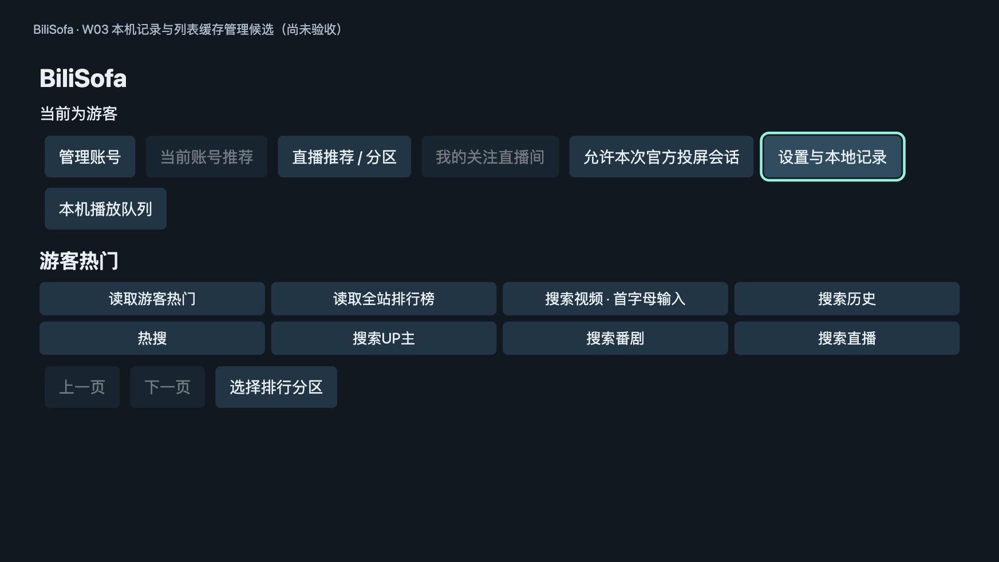
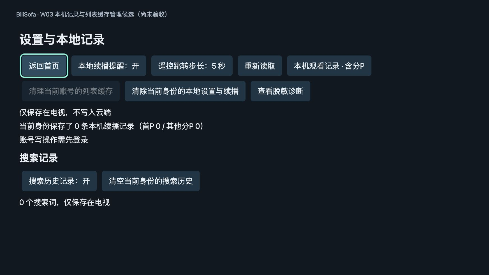
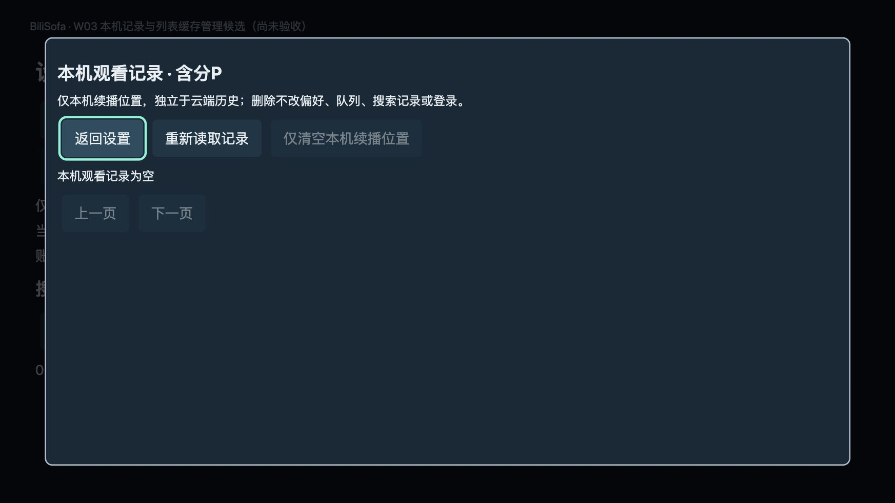
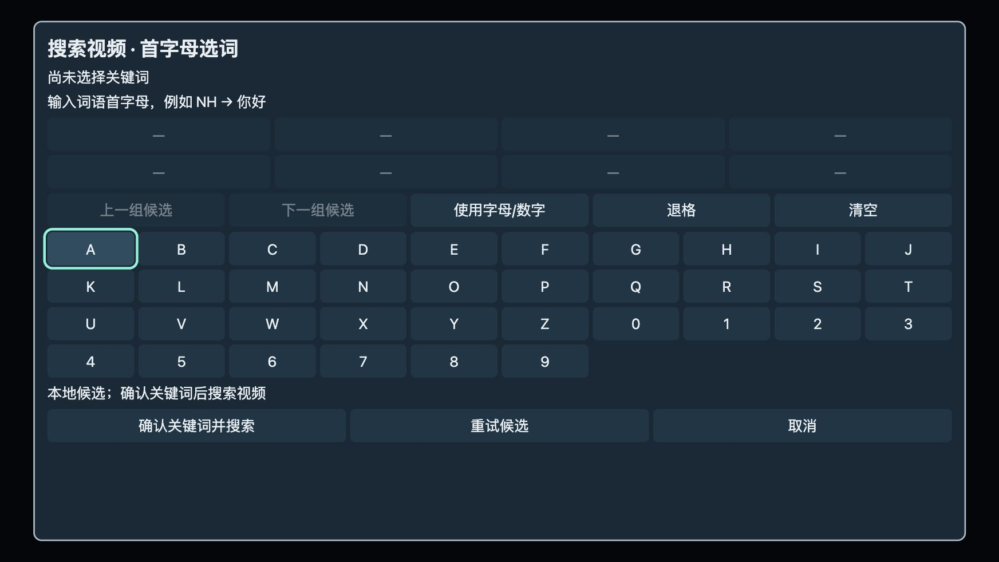

# 当前界面审视

2026-10-21；对象：现有0.28.0构建的游客首页、设置、本机记录空态、搜索输入。目的是为大屏产品化提供当前视觉证据，**不是重新验收这些功能或对同行TV客户端做实机审计**。

## 证据范围

使用本轮启动的只读本地静态服务与Codex内置浏览器，直接打开`dist/recommend-app`，未重建、注入fixture或修改页面样式/数据。未登录、未读取私人片库/凭据、未请求播放或真实账号写入。构建manifest的sourceHash为`580a87361f75e09c4092f1827ab48c175da45a7df422c742c43373a12f98774d`；静态“尚未验收”文案不代表最新验收状态。

保存图片实际为1745×982；浏览器读取viewport为1745×982、DPR约1.1、文档逻辑尺寸1920×1080。不能据此宣称已取得1920×1080电视截图，或把浏览器尺寸差异当电视裁切缺陷。初始未稳定的首页截图已丢弃，以下四张均在页面稳定后保存并重新打开核对；清单见[evidence.json](evidence/2026-10-21/evidence.json)。

## 1. 首页 — 产品入口待重构

进入后先见版本/工作包、账号和大量操作按钮，热门区为空，需要点“读取游客热门”。搜索类型、热搜、榜单和分页处于同一工具区，缺浏览层级；用户批准排除的直播入口仍存在。优点是文字大、焦点清楚。最高优先级：内容默认加载、稳定主导航、封面/标题卡、次级设置；不以登录管理作为所有用户的第一个任务。

## 2. 设置 — 数据安全说明可保留，组织需分组

路径：首页→设置与本地记录。页面加载、按钮语义可见；记录与搜索存储范围说明清楚。返回焦点在后续回到首页时恢复至“设置与本地记录”。

播放偏好、记录管理、数据清理、诊断混排在两行长按钮中，浏览时需要通读全文才知道影响范围。保留删除影响说明，改为“播放/字幕弹幕/本机数据/账号/帮助”分类；普通偏好和破坏性操作分区，危险动作预览与默认取消保留。焦点样式明显，但仅凭截图不能判定所有颜色对比或TV朗读合格。

## 3. 本机记录空态 — 有反馈，缺继续任务

路径：设置→本机观看记录。空态明确、无效清空/分页禁用；点返回设置，焦点恢复到原记录入口，属于可复用的正确行为。

主要观看记录被放在设置下的大型模态，空态仅提供重读/返回与禁用分页；应放进“我的/继续观看”，空时提供去浏览。删除管理保留在次级动作。**本轮空库未看到BV替代标题的问题**；该缺陷依据用户反馈及`local-bookmarks.ts`、`local-profile.ts`源码核查，不能说由这张图复现。

## 4. 搜索输入 — 可读且焦点明确，缺统一搜索上下文

路径：返回设置→返回首页→搜索视频·首字母输入。只打开输入，不输入或提交网络搜索。

首字母说明、候选、退格/清空和确认可辨认；空候选禁用。十列字母键横跨全屏，整个模态离开内容上下文，输入与结果分别出现；长期目标为一个搜索入口、显式类型和可收起输入区。6列键盘是待验证设计取舍，不声称已经减少所有词的按键次数。已有2×4候选邻接和Back清字母规则应复用，不能为改视觉重新引入首列不可达回归。

## 结论与限制

保留：明确真实焦点、大字、安全数据说明、禁用无效项、返回调用点。优先改变：页面信息架构、内容优先、封面与名称合同、观看记录入口、播放器/列表的一致表现；不是仅换颜色和圆角。

本轮没有观察真实内容卡、电视播放器/AVPlay、官方发送端、TV Voice Guide、Home/休眠或沙发观看距离；这些只有源码/既有设备证据，不能作为本次视觉审视的通过项。键盘与屏幕阅读器完整无障碍也未检查。产品化方案与集中验收见[设计规格](../TV_PRODUCT_DESIGN.md)和[收口台账](../PRODUCT_CLOSURE.md)。
